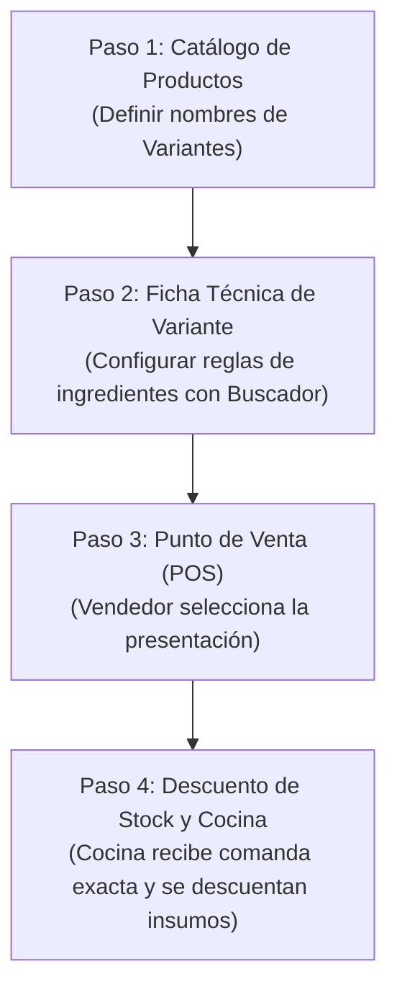

# Instructivo de Uso: Sistema de Presentaciones, Variantes e Insumos Inteligentes

Este manual describe el funcionamiento, configuración y operación del módulo de **Presentaciones y Variantes de Productos**, el nuevo **Buscador Inteligente de Insumos** y su impacto directo en el **Punto de Venta (POS)** y el **Control de Inventarios**.

---

## 1. ¿Cuál es el propósito de esta funcionalidad?

En un restaurante de comidas rápidas, un mismo producto (por ejemplo, *Hamburguesa Clásica*) suele venderse en distintas versiones:
* **Tamaños / Porciones:** Sencilla (1 carne), Doble Carne (2 carnes).
* **Recetas especiales:** Con jalapeños picantes, con tocineta crujiente.
* **Variantes de ingredientes:** Sin cebolla, con queso cheddar extra.

**El problema anterior:** Se debían crear múltiples productos en el catálogo, saturando la pantalla de ventas y complicando los reportes.  
**La solución actual:** Se crea un único producto base con su ficha técnica oficial, y se le añaden **Variantes**. Cada variante puede modificar automáticamente los ingredientes que se descuentan del inventario sin duplicar productos.

---

## 2. Flujo de Trabajo en 4 Pasos

---

## 3. Paso 1: Configurar las Variantes de un Producto

1. Ingresa al menú lateral en **Ventas → Productos**.
2. Ubica el producto que deseas configurar (por ejemplo, *Hamburguesa Clásica*) y haz clic en el botón **Editar** (icono de lápiz).
3. Avanza al **Paso 2: Presentaciones y Variantes**.
4. En esta sección:
   * Escribe el nombre de las opciones disponibles (ejemplo: `Carne picante con jalapeños`, `Doble Carne`).
   * Si necesitas agregar más variantes, haz clic en el botón rojo **+ Añadir Presentación**.
   * También puedes utilizar los atajos rápidos de sugerencias (`+ Sencilla`, `+ Doble Carne`, `+ Tamaño Familiar`, etc.).

---

## 4. Paso 2: Asignar Recetas a las Variantes (Buscador Inteligente)

Una vez definidas las variantes, avanza al **Paso 3: Modificaciones de Preparación**:

1. **Selecciona la variante** que vas a configurar en las pestañas superiores.
2. En la sección **"+ AÑADIR MODIFICACIÓN A ESTA VARIANTE"**, selecciona la **Acción**:
   * **+ Agregar insumo extra:** Añade un ingrediente que la hamburguesa base no tiene (ej. *Jalapeños en Rodajas*).
   * **Modificar cantidad de insumo:** Ajusta la porción de un ingrediente que ya existe en la base (ej. la carne pasa de 150g a 300g).
   * **Quitar insumo base:** Elimina un ingrediente de la receta (ej. *Sin Cebolla*).
   * **Reemplazar insumo:** Cambia un ingrediente por otro (ej. *Pan Tradicional* por *Pan Brioche*).

### ¿Cómo usar el nuevo Buscador Inteligente?
* Al elegir **"+ Agregar insumo extra"** o **"Reemplazar insumo"**, ya no tienes un menú desplegable gigante y lento.
* En su lugar, haz clic sobre el campo con la lupa:  
  **`Buscar insumo (ej. Jalapeño, Salsa)...`**
* Escribe parte del nombre del insumo (ejemplo: `jala`, `salsa`, `queso` o `pan`).
* El buscador filtrará en tiempo real mostrando:
  * El **Nombre** del insumo.
  * La **Categoría** a la que pertenece.
  * El **Stock actual** y su unidad de medida (ej. *9.98 kg*, *188 und*).
* Haz clic en el insumo deseado para seleccionarlo.  
  *(Si deseas cambiarlo, simplemente pulsa el botón **Cambiar** y vuelve a escribir).*
* Digita la **Cantidad** a utilizar (ejemplo: `30` gramos).
* Presiona el botón rojo **"+ Guardar Modificación en Variante"**.
* Para finalizar, presiona **"Guardar Cambios"** en el pie del modal.

---

## 5. Paso 3: Operación en el Punto de Venta (POS)

1. Ingresa a **Ventas → POS Vendedor** (o pulsa *"+ Crear venta"* en Gestión de Ventas).
2. Haz clic sobre la tarjeta de la **Hamburguesa Clásica**:
   * Si el producto tiene variantes configuradas, el sistema desplegará automáticamente la ventana de selección de presentaciones.
   * El cajero o mesero hace clic en la presentación que pidió el cliente (por ejemplo: *Carne picante con jalapeños*).
3. El producto se añadirá al carrito de compras con su respectiva variante identificada.
4. Completa la orden seleccionando el método de pago (Efectivo, Transferencia, etc.) y pulsa **Confirmar Pedido**.

---

## 6. Paso 4: ¿Qué ocurre por detrás en el Sistema?

1. **En Cocina / Comandas:**
   * La comanda enviada al cocinero indica expresamente la variante elegida (ej. *Hamburguesa Clásica - Carne picante con jalapeños*), garantizando que el personal de cocina prepare el plato con los ingredientes correctos.
2. **En Inventarios / Insumos:**
   * El sistema descuenta los insumos base del plato, **más** los 30g de jalapeños configurados en la variante.
   * Si la variante era *Doble Carne*, descontará la porción duplicada de carne.
   * No requiere intervención manual del administrador para cuadrar existencias.

---

## 7. Consejos y Buenas Prácticas

> [!TIP] Recargar la caché tras actualizaciones
> Si al ingresar al modal de variantes continúas viendo el desplegable viejo en tu navegador, presiona **`Ctrl + F5`** (o `Ctrl + Shift + R`) para forzar al navegador a cargar los archivos JavaScript actualizados.

> [!IMPORTANT] Insumos con Stock
> Al agregar insumos extras en una variante, verifica en el buscador que el insumo tenga stock suficiente disponible para evitar alertas de agotado en el POS.

